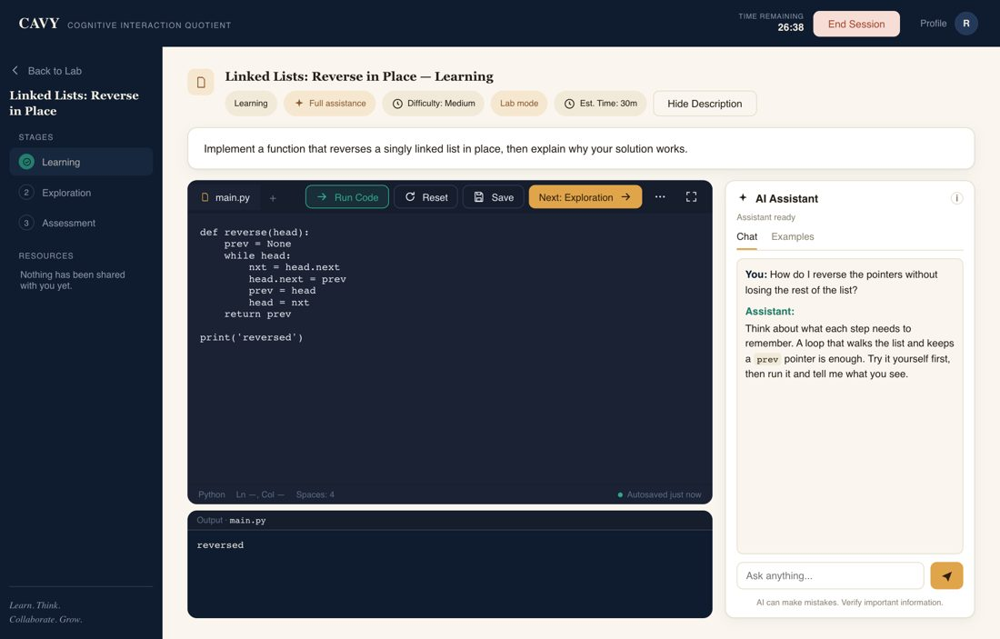
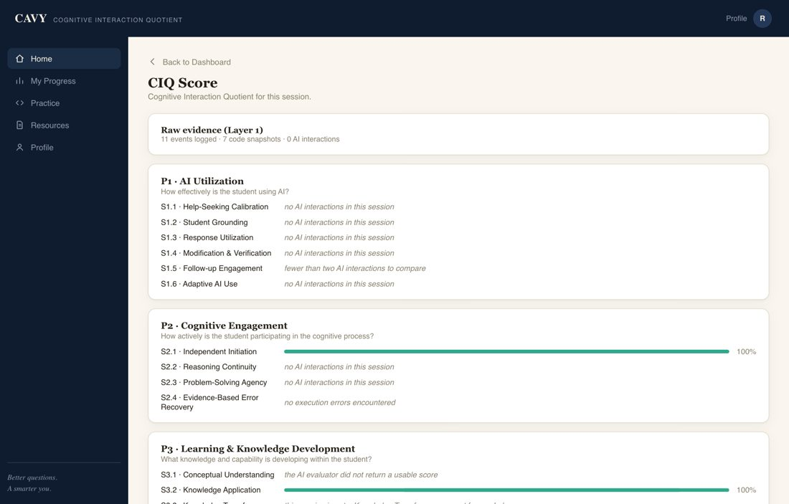
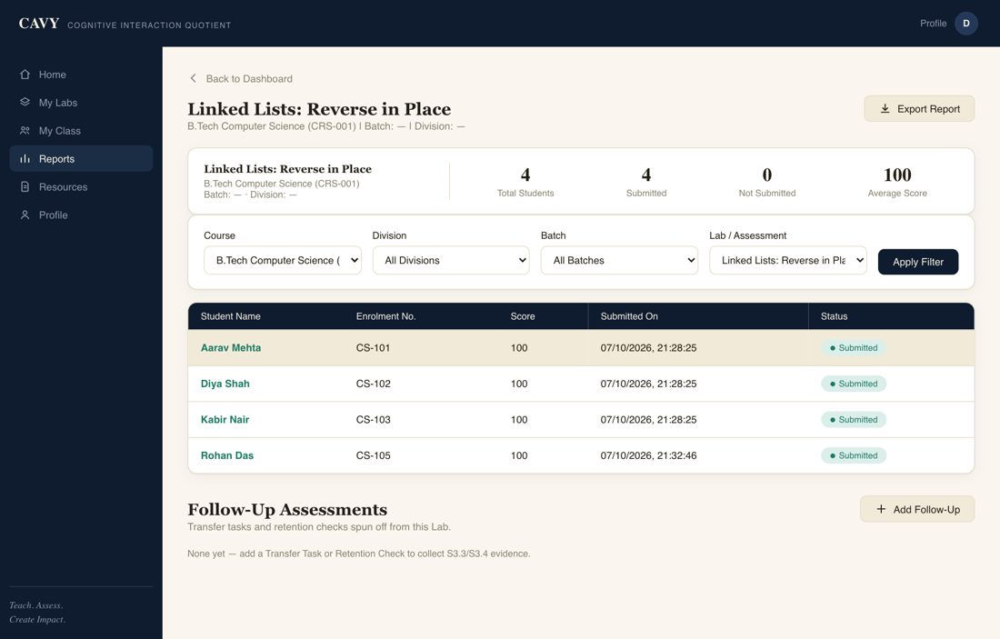
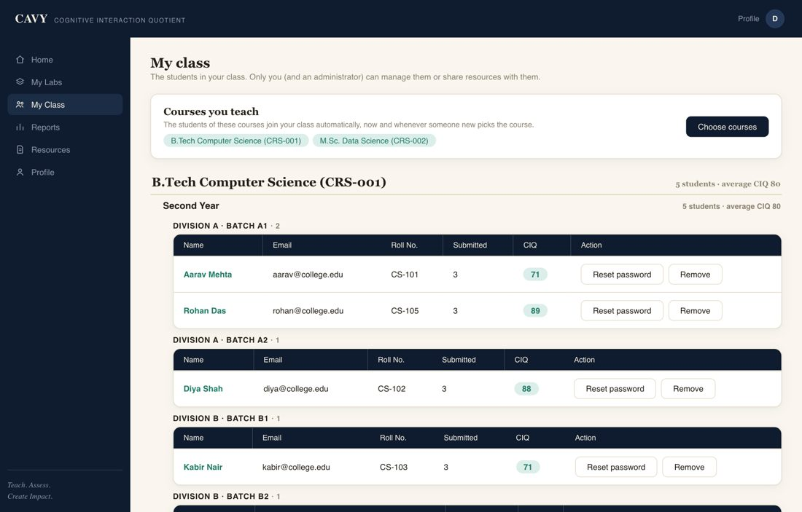
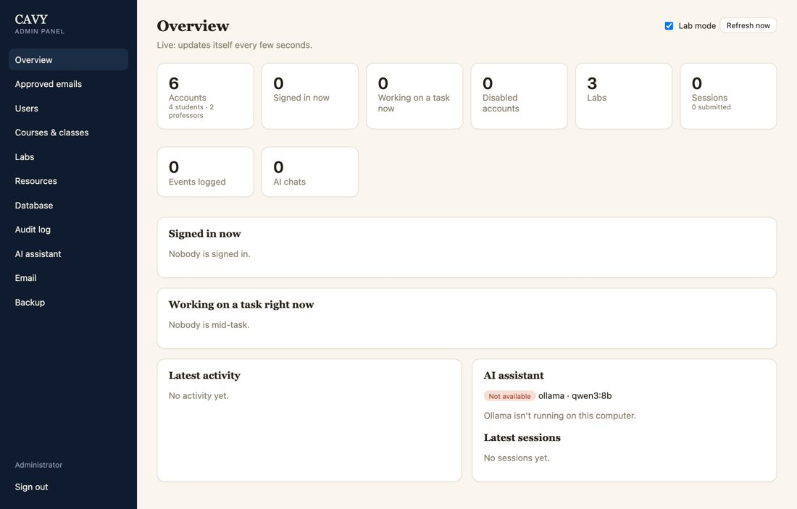
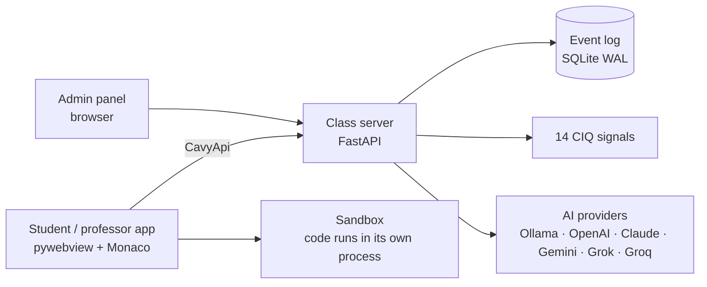

<h1 align="center">🧠 CAVY</h1>
<p align="center"><b>Who really did the thinking, the student or the AI?</b><br>
A coding-lab platform that watches <i>how</i> students work with AI, and turns it into a score: the <b>Cognitive Interaction Quotient</b>.</p>

<p align="center">
  <a href="https://github.com/ViralKariya-VK/eaal-platform/releases"></a>
  <a href="https://www.figma.com/design/1rHhK4KU4ndumQBopIkcT1/CAVY-Platform-Wireframe?node-id=0-1"></a>
  
  
</p>

<p align="center"></p>

> *In the age of AI, we are measuring the answers, but we have stopped measuring the thinker.*

---

## 🕵️ The mystery

Two students hand in the **same correct code**.

- 🧑‍🎓 **Student A** asked the AI a sharp question, tried the answer, broke it, fixed it, and could explain it afterwards.
- 🧑‍🎓 **Student B** pasted the AI's reply and pressed Submit.

Every tool we tried says they are the same: AI detectors judge the text, proctoring treats AI as a crime, coding
platforms grade the output, dashboards count clicks, and assistants just help. In 2025, **88%** of UK undergraduates
had used generative AI for assessments, up from 53% a year earlier (HEPI), and **84%** of developers use or plan to
use AI tools (Stack Overflow). The question is no longer *"did they use AI?"* but

### *"How did they learn while using it?"*

CAVY is our answer. Students do their labs with an AI assistant sitting right there. CAVY quietly records every
prompt, reply, edit and run as a trail of events, and computes **14 behavioural signals** from that trail. The
result: a CIQ per session, a progress page for the student, and a real window into the class for the professor.

## 🎬 Meet the cast

| | What they get |
|---|---|
| 🧑‍🎓 **The student** | A lab in three stages (Learning → Exploration → Assessment), an AI helper, then a "explain it in your own words" moment, a CIQ, and a progress page that says what to work on. |
| 🧑‍🏫 **The professor** | Labs aimed at the right division and batch, resources to share, each student's *actual* code, AI chat and signals, and a report they can export. |
| 🛠️ **The admin** | A browser panel to load the college's students, manage courses, email, lab mode, audit log and backups. |

<table>
<tr>
<td width="50%"><br><sub><b>The student sees</b> the CIQ and the evidence behind every signal.</sub></td>
<td width="50%"><br><sub><b>The professor sees</b> who finished, how they scored, and can open any student's work.</sub></td>
</tr>
<tr>
<td width="50%"><br><sub><b>Classes</b> follow course, year, division and batch.</sub></td>
<td width="50%"><br><sub><b>The admin</b> runs everything from a browser tab.</sub></td>
</tr>
</table>

Want every screen? There's a full [walkthrough PDF](docs/CAVY-Application-Walkthrough.pdf), and the design started as
[wireframes on Figma](https://www.figma.com/design/1rHhK4KU4ndumQBopIkcT1/CAVY-Platform-Wireframe?node-id=0-1).

## 🔬 The science bit

CAVY builds on the **AIQ** framework for human-AI collaboration (Ganuthula and Balaraman, 2025) and the literature
on automation bias and over-reliance (Alon-Barkat and Busuioc, 2023; Klingbeil et al., 2024; Glickman and Sharot,
2025), and moves the measurement from *outcomes* to *process*. Scores are **pure functions of an event log**, so
anyone can recompute them and get the same answer.

Two hypotheses we want to test:
1. Users with generative AI finish faster but show lower cognitive independence than users without it.
2. Feedback on AI reliance changes cognitive independence over time.

### The 14 signals, in three pillars

| Pillar | Signals |
|---|---|
| **P1 · Using AI well** | S1.1 Help-seeking calibration · S1.2 Student grounding · S1.3 Response utilization · S1.4 Modification and verification · S1.5 Follow-up engagement · S1.6 Adaptive AI use |
| **P2 · Thinking for yourself** | S2.1 Independent initiation · S2.2 Reasoning continuity · S2.3 Problem-solving agency · S2.4 Evidence-based error recovery |
| **P3 · Actually learning** | S3.1 Conceptual understanding · S3.2 Knowledge application · S3.3 Knowledge transfer · S3.4 Retention and recall |

No evidence? The signal says **"none, and here's why"**. CAVY never makes up a number.

### Does it measure what it claims?
A separate validation suite ([`validation/`](validation/)) says yes, with limits: **53/53** known-answer trials match
exactly, **10/10** "no evidence" cases return *none*, **88/88** recomputations are identical, and the three
model-scored signals agree with hand-labelled examples (Spearman r = 0.84 to 0.87). What it does **not** prove is
that CIQ predicts real learning. That needs a study with real students, which is the next chapter
([methods and limits](validation/report/VALIDATION_REPORT.pdf)).

## 🔒 Lab mode: the "stay in the room" rule

Switch it on and the lab goes full screen, switching apps is blocked (where the OS allows it), and pasted text is
recorded and checked against what the AI wrote. Leave the window once: warning. Twice: auto-submit. The admin can
switch it off for the whole class.

## 🏫 Built for how a college really runs

- **SAP IDs and calendars, not dropdowns.** A student is a SAP ID plus an admission year. Their year and semester
  are *worked out*: the academic year starts on **1 July**, so on 1 July everyone moves up by themselves. A 2025
  MSc student shows as *Batch of 2025-2027 · Year 2 · Sem III*.
- **Real structure.** Programmes (MSc / BSc Data Science, Statistics and Data Science, Applied Statistics and
  Analytics), divisions, and **Batch 1 / Batch 2** as the first and second half of a division.
- **One import.** Upload the college's student list, check the preview, create the accounts. The official list wins
  every conflict; wrong SAP IDs in a division sheet are fixed by matching names. Students sign in with their **SAP ID**
  and choose their own password at first login. Details: [docs/COLLEGE_SETUP.md](docs/COLLEGE_SETUP.md).

## 🚀 Get it

**Just use it:** grab the installer for your system from [Releases](https://github.com/ViralKariya-VK/eaal-platform/releases)
(macOS `.dmg`, Windows `.exe`). They're not code-signed yet, so your OS will frown at first launch; the release notes
say how to wave it through. For a class, one computer hosts the server and the others type its address
([classroom guide](docs/DEMO_SETUP.md)).

**Stay current:** from 0.2.0 the app tells you when a newer version is out (one small notice, never during a lab).
A server and the apps that connect to it must run **exactly the same version**, otherwise they politely refuse to
talk and tell you which side to update. How we ship updates: [docs/RELEASING.md](docs/RELEASING.md).

**Run it from source:**

```bash
conda create -n eaal-platform python=3.11 && conda activate eaal-platform
python -m pip install -r requirements.lock && python -m pip install -e . --no-deps
python -m eaal_platform.app              # the desktop app
python -m eaal_platform.server           # the classroom server (admin panel at /admin)
```

You'll want [Ollama](https://ollama.com) for the local assistant (`ollama pull qwen3:8b`), or a key for OpenAI,
Claude, Gemini, Grok or Groq. The first admin password: `get-admin-password.command` (macOS) or
`get-admin-password.bat` (Windows).

## 🧰 Under the hood

Python backend, web front end, one native window, no Electron. [pywebview](https://pywebview.flowrl.com/) shows the
UI in the system's web view and exposes one Python object, `CavyApi`, to its JavaScript. FastAPI serves the class
server and admin panel; SQLite (WAL) + SQLAlchemy keep an append-only event log.



```
src/eaal_platform/
  api/  client/  server/  db/  signals/  events/  sandbox/  ai/  web/
validation/   the research: does CIQ compute what it claims?
packaging/    PyInstaller · Inno Setup · dmg recipes
```

Why each choice (and what we compared it with) is in the [software report](docs/Audit%20Report.pdf).

## ✅ Receipts

| | |
|---|---|
| Tests | 562 passing, 90% line + branch coverage |
| Static checks | Ruff 0 · mypy strict 0 · Bandit 0 · pip-audit clean on 151 pinned packages |
| Complexity | average grade A (3.2), nothing above 13 |
| Mutation testing | 83% of mutants killed on the scoring engine |
| Speed | 30 students at once: ~800 calls/second, none failed; 100 students: none failed ([details](docs/PERFORMANCE.md)) |
| QA | a screen-by-screen audit at five window sizes ([docs/QA_AUDIT.md](docs/QA_AUDIT.md)) |

```bash
ruff check . && mypy src && pytest        # the quality gate
python scripts/benchmark.py --students 30
```

## 🙈 Honest limits

- The classroom network speaks plain HTTP (no HTTPS yet) and the installers aren't code-signed.
- `api/bridge.py` is one very large class. We know. It's next on the list.
- Lab mode can't block every OS escape hatch (hello, Ctrl+Alt+Del) and has been tested most on macOS.
- The signals are validated for *correctness and repeatability*, not yet against real learning outcomes; the CIQ
  weighting is provisional.
- Subjects, per-batch teaching assignments and a "start the new academic year" screen are the next college features.

## 🗺️ What's next

A pilot in one real class (with a survey), HTTPS and signed installers, splitting the bridge module, subjects and
teaching assignments, labs given to both batches at once, and adaptive AI help that tightens or loosens as a student
grows. See [docs/ROADMAP.md](docs/ROADMAP.md).

## 🎓 The team

**Group 04, NMIMS**: Viral Kariya · Vanshika Ahuja · Yashika Parmar · Carol Maria

## 📚 References

- Ganuthula, V. R. R., and Balaraman, K. K. (2025). Artificial intelligence quotient framework for measuring human
  collaboration with artificial intelligence. *Discover Artificial Intelligence, 5*, 268.
- Klingbeil, A., Grützner, C., and Schreck, P. (2024). Trust and reliance on AI: an experimental study on the extent
  and costs of over-reliance on AI. *Computers in Human Behavior, 160*, 108352.
- Alon-Barkat, S., and Busuioc, M. (2023). Human-AI interactions in public sector decision making: "automation bias"
  and "selective adherence" to algorithmic advice. *Journal of Public Administration Research and Theory.*
- Glickman, M., and Sharot, T. (2025). How human-AI feedback loops alter human perceptual, emotional and social
  judgements. *Nature Human Behaviour, 9*(2), 345-359.
- Zheng, J., et al. (2025). Do students rely on AI? Analysis of student-ChatGPT conversations from a field study.
- Higher Education Policy Institute (2025). *Student Generative AI Survey 2025.*
- Stack Overflow (2025). *Developer Survey 2025.*
